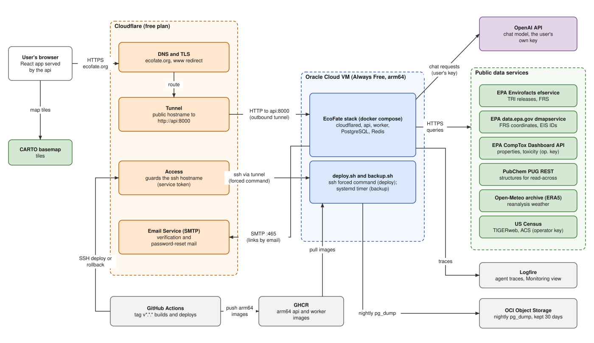

# EcoFate

EcoFate turns fragmented environmental data into screening-level chemical exposure risk profiles.
Live at **https://ecofate.org**: sign up, save your own OpenAI key, ask about a chemical.

## The problem

Public health researchers, environmental risk assessors and community advocates struggle to
evaluate localized chemical exposure quickly: the data on industrial releases, chemical
properties and environmental transport are spread across many separate databases.

## What it does

- **Asks in plain words**: a user names a chemical (by CAS number), a place or a facility; a
  LangGraph agent decides which of its 12 tools to call.
- **Joins public data with transport models**: EPA TRI releases, chemical properties and
  toxicity benchmarks, stack parameters, weather and census population feed deterministic
  dispersion and exposure equations, for the community and for workers.
- **Returns a screening-level risk profile**: an overview, a facility map and a downloadable
  report, with every value's source, and stops to ask when a value it needs is missing.

Quick start: `cp .env.example .env`, fill it in, then `docker compose --profile dev up --build`
([Getting started](docs/getting-started.md)).

## Documentation

**Start here**

| Page | What it covers |
|---|---|
| [Demo](docs/demo.md) | One real assessment in screenshots: question, answer, dashboard, map, monitoring, evaluation |
| [Getting started](docs/getting-started.md) | Docker, the `make` targets, local development with uv, the command line |
| [For reviewers](docs/reviewers.md) | Where each capstone criterion is and how to check it |
| [Architecture](docs/architecture.md) | Layers and dependency rules, runtime containers, a turn's path |

**Understand the code**

| Folder | What it covers |
|---|---|
| [agent/](agent/README.md) | The LangGraph graph, its guards, asking for missing values, swapping the LLM |
| [tools/](tools/README.md) | The 12 tools, the batch assessment, adding a tool |
| [models/](models/README.md) | The deterministic equations and their units |
| [prompts/](prompts/README.md) | Prompt files and the registry |
| [config/](config/README.md) | Settings files, the production override, adding a setting |
| [api/](api/README.md) | Endpoints, accounts and email, BYOK keys, daily limit, streaming |
| [worker/](worker/README.md) | The Redis/Celery worker and resumable turns |
| [storage/](storage/README.md) | PostgreSQL tables, migrations, conversation checkpoints |
| [frontend/](frontend/README.md) | The workspace: what it shows and does not, running and testing it |

**Check and operate it**

| Page | What it covers |
|---|---|
| [evals/](evals/README.md) | Scenarios, the hand-written catalogue, labels, the LLM judge and its tuning |
| [Load test](docs/load-test.md) | 10 to 50 users at once: queue waits, background jobs, where the limit is |
| [Monitoring](docs/monitoring.md) | Logfire traces, redaction, the admin Monitoring view |
| [Security](docs/security/README.md) | BYOK, key encryption, tenancy, sessions, rate limit, secrets |
| [Deployment](docs/deployment/README.md) · [deploy/](deploy/README.md) | Oracle Cloud + Cloudflare, release, rollback, backups |
| [Development](DEVELOPMENT.md) | Set-up, checks, tests, where things go, CI and releasing |
| [License and citation](docs/citation.md) | Apache 2.0, the Zenodo DOI, releasing a version |
| [All docs](docs/README.md) | Everything under `docs/`, including design principles and UI audits |
