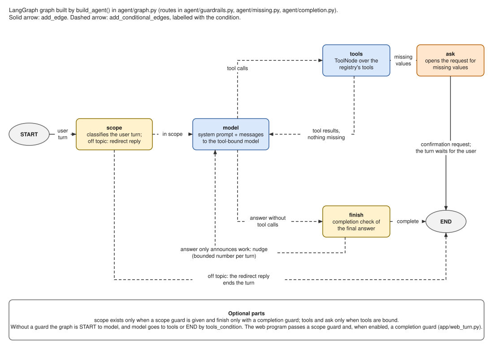

[← Documentation index](../README.md#documentation) · [Architecture](../docs/architecture.md) · [Tools](../tools/README.md) · [Prompts](../prompts/README.md)

# agent/

The LangGraph agent: graph wiring, state and two guards. It is orchestration only. It takes a
chat model by injection (any `BaseChatModel` that supports tool calling), gets its tools from
`tools.registry` and its system prompt from `prompts/`, and holds no domain or calculation logic.
Rules for coding agents: `agent/CLAUDE.md`.

## Contents

- [Modules](#modules)
- [The graph](#the-graph)
- [Asking for missing values](#asking-for-missing-values)
- [Guards](#guards)
- [Swapping the LLM provider](#swapping-the-llm-provider)
- [Running and testing](#running-and-testing)

## Modules

| Module | What it holds |
|---|---|
| `graph.py` | `build_agent(model, tools, system_prompt, checkpointer, scope_guard, completion_guard)`: compiles the graph |
| `state.py` | `AgentState`: the append-only `messages`, the open `pending` confirmation request, the `answers_note` |
| `missing.py` | gathers the `missing` lists of a turn's tool results into one confirmation request and ends the turn with it |
| `guardrails.py` | `ScopeGuard`: a model check that a request is on topic, with a redirect when it is not |
| `completion.py` | `CompletionGuard`: a model check that an answer did not stop early, with a nudge to continue |

## The graph



*Drawn from `agent/graph.py`, `agent/missing.py`, `agent/guardrails.py` and `agent/completion.py`.*

Nodes: `scope` (optional), `model`, `tools`, `ask` and `finish` (optional).

- `START` goes to `scope` when a scope guard is given, otherwise straight to `model`. After `scope`,
  an off-topic turn ends with the redirect and the tool-bound model is never called; otherwise the
  flow continues to `model`.
- `model` is the chat model with the tools bound and the system prompt in front of the messages.
  When it asks for tool calls the flow goes to `tools`; when it answers, the flow goes to `finish`
  (or to `END` when there is no completion guard).
- After `tools` the flow goes to `ask` if any tool result reported missing values, otherwise back to
  `model`. `ask` ends the turn.
- `finish` reviews the answer: one that only announces work it will do next sends the agent back to
  `model` with a nudge, at most `max_nudges` (2) times per turn; otherwise the turn ends.

The command-line program builds the graph with the completion guard only (`app/run.py`); the web
program builds it with both guards (`app/web_turn.py`). The model's step limit per run is
`[agent].recursion_limit` (80), and a stopped turn can be resumed from its checkpoint
(`[agent].max_resumes_per_turn`, 3).

## Asking for missing values

The tools decide what is missing (their `missing` lists carry an `entry_id`, the quantity, the
subject, accepted units and a plausible range); `agent/missing.py` only collects them, removes
repeats and writes the request. The turn then stops with a message and an open request. The user
enters a value for each entry or proceeds without it, and a value that is not entered stays missing
and is reported as such. Nothing is guessed.

## Guards

Both guards are opt-in nodes that use the injected model, take their prompt text from `prompts/`
(`scope_classifier.md`, `scope_redirect_fallback.md`, `completion_check.md`, `completion_nudge.md`)
and import no provider.

- **Scope:** classifies the latest user message, in the light of a short window of earlier turns
  (`history_window`, 6), as in or out of scope. It fails open on purpose (a classifier error lets
  the turn through; the agent that follows is still bound to its tools and prompt).
- **Completion:** judges the final reply against the request; a reply that defers the copilot's own
  work gets a named nudge message so the interface and the scope check can leave it out.

## Swapping the LLM provider

Change `[agent]` in `config/settings.toml` (provider, model, API-key variable, timeout, step limit);
a new provider is an entry in `app/chat_model.py`. The program and the evaluations both build the
model there, so they always run the same one. Underneath, `build_agent` accepts any
`langchain_core.language_models.BaseChatModel` that supports tool calling. It never imports a
provider, so you construct the model and inject it:

```python
from agent import build_agent

# OpenAI
from langchain_openai import ChatOpenAI

agent = build_agent(ChatOpenAI(model="gpt-4.1"))

# Anthropic
from langchain_anthropic import ChatAnthropic

agent = build_agent(ChatAnthropic(model="claude-sonnet-5-5"))

# Vertex AI
from langchain_google_vertexai import ChatVertexAI

agent = build_agent(ChatVertexAI(model="gemini-2.5-pro"))

agent.invoke({"messages": [("user", "Assess benzene (71-43-2) emissions")]})
```

Install the matching integration package yourself (for example `uv add langchain-anthropic`); none
is a hard dependency.

## Running and testing

    uv run python -m app "Assess CAS 71-43-2"    # one run from the command line (needs an OpenAI key)
    uv run pytest tests/agent                     # graph, guards and missing-value tests (fake chat model)

The tests use a scripted fake chat model and never call a provider. How the agent is evaluated
against a real model: [evals](../evals/README.md).
