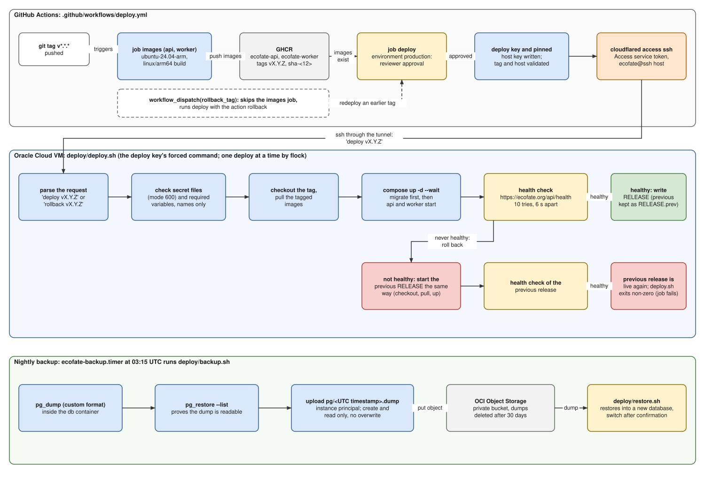

[← Documentation index](../README.md#documentation) · [Architecture](../docs/architecture.md) · [Deployment guide](../docs/deployment/README.md) · [Security](../docs/security/README.md)

# deploy/

The scripts and templates that put EcoFate on its production VM (Oracle Cloud Always Free, behind a
Cloudflare tunnel) and keep it running. The step-by-step guide (prerequisites, Cloudflare set-up,
first login, GitHub settings, first release, logs, backups, teardown) is
[docs/deployment/](../docs/deployment/README.md); this page says what each file does.

## Contents

- [Files](#files)
- [Release and rollback](#release-and-rollback)
- [Secrets and templates](#secrets-and-templates)
- [Make targets](#make-targets)

## Files

| File | Runs on | What it does |
|---|---|---|
| `oci/provision.sh` | your machine | creates the Oracle Cloud resources: network (no inbound rule from the internet), the Ampere A1 VM started with `cloud-init.yaml`, the Bastion for your IP only, a private backup bucket and the permission that lets only the VM write to it; idempotent; refuses shapes above the Always Free limits |
| `oci/cloud-init.yaml` | the VM, first boot | installs Docker and the OCI CLI, creates the `ecofate` user, clones the repository to `/opt/ecofate/app` and enables the backup timer |
| `oci/bastion-ssh.sh` | your machine | opens a one-hour Bastion port-forward and logs you in as `ecofate` (first login, emergencies) |
| `oci/teardown.sh` | your machine | deletes everything `provision.sh` created, after you type the bucket name; irreversible |
| `oci/config.env.example` | your machine | the settings `provision.sh` reads (copy to `config.env`) |
| `deploy.sh` | the VM | deploys or rolls back one release; the forced command of the deploy key |
| `lib.sh` | the VM | shared paths and the one way to run compose (`/opt/ecofate`, `.env.prod`, `tunnel.env`, `RELEASE`) |
| `backup.sh` | the VM | nightly `pg_dump` of the whole database to Object Storage as `pg/<UTC timestamp>.dump` |
| `ecofate-backup.service`, `ecofate-backup.timer` | the VM | run the backup every night at 03:15 UTC |
| `restore.sh` | the VM | restores a dump into a new database, shows row counts and switches only after you type `switch` |
| `env.prod.example`, `tunnel.env.example` | the VM | templates of the two secret files (names only) |

The production compose overrides are `compose.prod.yaml` in the repository root and the production
settings are `config/settings.production.toml` ([config](../config/README.md#production-overlay)).

## Release and rollback

*Drawn from `.github/workflows/deploy.yml`, `deploy/deploy.sh`, `deploy/lib.sh` and `compose.prod.yaml`.*

1. Pushing a tag `vX.Y.Z` starts `.github/workflows/deploy.yml`. Its `images` jobs build the `api`
   and `worker` images on an arm64 runner and push them to GHCR as `<tag>` and `sha-<commit>`.
2. The `deploy` job runs in the `production` environment, so it waits for a reviewer's approval. It
   then connects over SSH through the Cloudflare tunnel (an Access service token) with a key that
   can run only `deploy.sh`, and sends `deploy vX.Y.Z`.
3. `deploy.sh` checks the two secret files and every required variable (names only, never values),
   moves the checkout to the tag, pulls the tagged images, starts the stack (migrations run first;
   `api` and `worker` start only if they succeed) and checks the public `/api/health`.
4. If the new release never reports healthy, `deploy.sh` deploys the previous release again and exits
   non-zero (the job goes red, which is the expected result).
5. To go back to an earlier release on purpose: **Actions -> Deploy -> Run workflow** with
   `rollback_tag` = `vX.Y.Z` (its images must still be in GHCR). Migrations only add to the schema
   within a release, so an older release runs on the migrated schema.

`deploy.sh` accepts only `deploy vX.Y.Z` and `rollback vX.Y.Z` and runs from a private copy of
itself, because the checkout it lives in moves to the new tag while it runs. The recorded rollback
and restore drills are in [docs/deployment/](../docs/deployment/release-and-rollback.md#rollback).

## Secrets and templates

The two secret files exist only on the VM, mode 600, owner `ecofate`: `/opt/ecofate/.env.prod` (the
database password, key-encryption key, session secret, data-service keys, SMTP settings, backup
bucket name, `LOGFIRE_TOKEN` and `LOGFIRE_READ_TOKEN`) and `/opt/ecofate/tunnel.env` (the Cloudflare
tunnel token). `deploy/env.prod.example` and `deploy/tunnel.env.example` list the variable names; fill
the values on the VM and never commit them. See [security](../docs/security/secrets-and-checks.md#secrets-in-ci-and-production).

## Make targets

    make deploy-provision    # create the Oracle Cloud resources (reads deploy/oci/config.env)
    make deploy-ssh          # SSH into the VM through the Bastion
    make deploy-backup       # on the VM: dump the database to Object Storage now
    make deploy-restore DUMP=<UTC timestamp>   # on the VM: restore a dump
    make deploy-teardown     # delete every Oracle Cloud resource provision created (asks to confirm)
