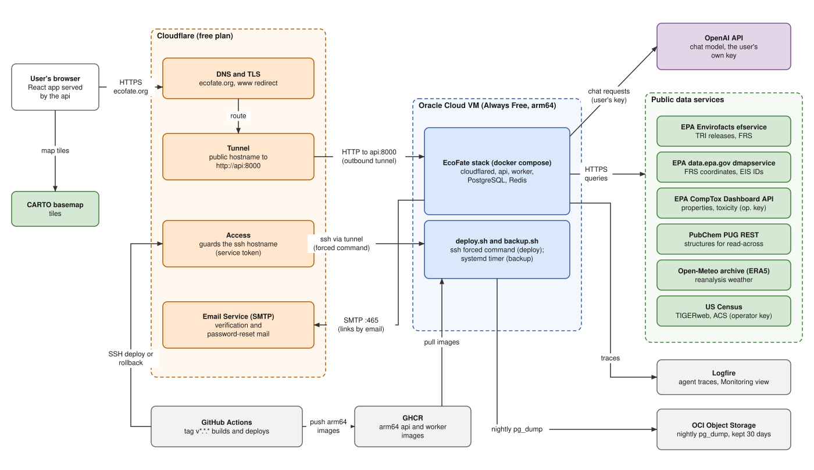
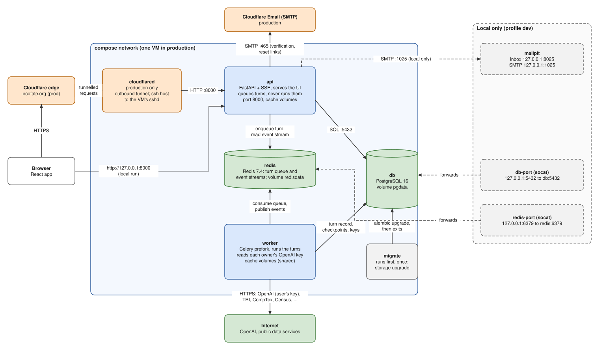
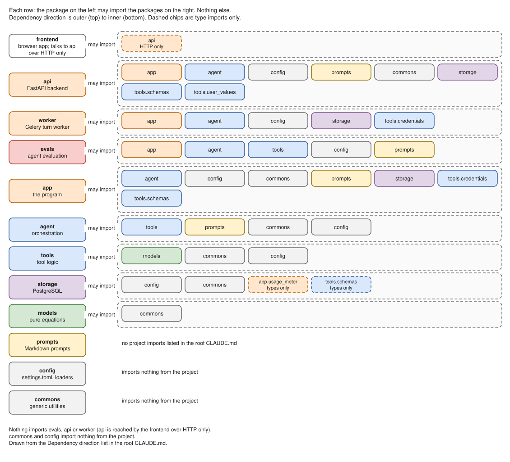

[← Documentation index](../README.md#documentation) · [Security](security/README.md) · [Deployment](deployment/README.md)

# Architecture

How EcoFate is divided into packages, which way their dependencies point, which processes run
at runtime and how one chat turn travels through them.

## Contents

- [System context](#system-context)
- [Runtime containers](#runtime-containers)
- [Package layers](#package-layers)
- [Dependency rules](#dependency-rules)
- [A turn's path](#a-turns-path)
- [Where state lives](#where-state-lives)
- [Configuration and secrets](#configuration-and-secrets)

## System context

*Drawn from `compose.yaml`, `compose.prod.yaml`, `docs/deployment/README.md` and the `[comptox]`, `[efservice]`, `[meteorology]`, `[population]`, `[pubchem]` tables of `config/settings.toml`.*

Users sign in with a browser. In production Cloudflare serves `https://ecofate.org` and forwards it
through a tunnel to the VM ([deployment](deployment/README.md)). The system calls the OpenAI API with
**the user's own key** (bring your own key, see [security](security/README.md)) and the public data services
the tools read (EPA CompTox and Envirofacts, PubChem, Open-Meteo, the US Census). Locally, the
same compose stack runs on the developer's machine.

## Runtime containers

*Drawn from `compose.yaml`, `compose.prod.yaml` and the `Dockerfile` (targets `api` and `worker`).*

| Service | What it is | Where |
|---|---|---|
| `db` | PostgreSQL 16, data in the `pgdata` volume; not published to the host | local and production |
| `redis` | Redis 7.4: the two Celery queues (`chat` and `tools`, the broker) and each turn's live event stream; not published | local and production |
| `migrate` | one-shot job: applies the Alembic migrations, then exits | local and production |
| `api` | the web program: FastAPI, serves the built React app, queues each chat turn, relays its events over SSE; never runs the agent | local and production |
| `worker` | Celery worker for the `chat` queue (same code as `api`, image target `worker`; `python -m worker chat`): runs the queued turns | local and production |
| `tool-worker` | the same image, started on the `tools` queue (`python -m worker tools`): runs background tool jobs, so a long job never delays a chat turn (queue names, sizes and limits: `[worker.chat]`, `[worker.tools]`) | local and production |
| `mailpit` | mail catcher for verification and reset emails (inbox `http://127.0.0.1:8025`) | local, `dev` profile only |
| `db-port`, `redis-port` | `socat` forwarders that publish PostgreSQL and Redis on the host's loopback for native runs | local, `dev` profile only |
| `cloudflared` | outbound-only tunnel to Cloudflare | production only |

`api`, `worker` and `tool-worker` start only after `migrate` succeeded and `db` and `redis` are healthy. The `api`
port is published on the host's loopback only (`127.0.0.1:8000`). Folder details:
[api](../api/README.md), [worker](../worker/README.md), [storage](../storage/README.md),
[deploy](../deploy/README.md).

## Package layers

*Drawn from the dependency rules in the root `CLAUDE.md`, enforced in part by `tests/test_layering.py`.*

| Package | Role | README |
|---|---|---|
| `models/` | pure deterministic NumPy equations, units in every docstring | [models](../models/README.md) |
| `tools/` | the agent's tools, grouped by concern; the batch assessment composes them | [tools](../tools/README.md) |
| `agent/` | LangGraph wiring, state and guards; provider-agnostic | [agent](../agent/README.md) |
| `prompts/` | Markdown prompt files and the loader | [prompts](../prompts/README.md) |
| `config/` | `settings.toml` and typed loaders | [config](../config/README.md) |
| `commons/` | small generic pure utilities (units, sealed secrets, payload guard, key patterns) | no README |
| `app/` | the program: the one chat-model factory, key vaults, telemetry, the turn runner | no README |
| `storage/` | PostgreSQL: engine, tables, migrations, repositories | [storage](../storage/README.md) |
| `api/` | the web backend (FastAPI, SSE) | [api](../api/README.md) |
| `worker/` | the Celery worker that runs turns | [worker](../worker/README.md) |
| `frontend/` | the React app, talks only to `/api` | [frontend](../frontend/README.md) |
| `evals/` | agent evaluation (outer edge) | [evals](../evals/README.md) |

## Dependency rules

Dependencies point one way:

- `agent` -> `tools` -> `models`; `agent` -> `prompts`.
- `agent`, `tools` and `models` -> `commons`; `agent` and `tools` -> `config`.
- `app` -> `agent`, `config`, `commons`, `prompts`, `storage` (checkpointer, user key vault, turn
  queue), `tools.credentials` and `tools.schemas`.
- `worker` -> `app`, `agent`, `config`, `storage`, `tools.credentials`.
- `api` -> `app`, `agent`, `config`, `prompts`, `commons`, `storage`, `tools.schemas`,
  `tools.user_values`.
- `storage` -> `config`, `commons` (and types from `app.usage_meter` and `tools.schemas`).
- `evals` -> `app`, `agent`, `tools`, `config`, `prompts`.
- `frontend` -> `api`, over HTTP only.
- `commons` and `config` import nothing from the project; nothing imports `evals`, `api` or `worker`.

Two consequences worth knowing: `models/` knows nothing about LLMs or LangChain, and no provider
package is imported outside `app/chat_model.py` (chat models), `tools/emissions/rag/embeddings.py`
(embeddings) and the MolDeBERTa loader in `tools/informatics/helpers/read_across/`. The API and the
worker never import each other; both run turns through `app/turns/`.

## A turn's path

1. The browser posts a message to `POST /api/v1/chat/stream`. The API checks the session, the daily
   limit and the thread, records the turn as `queued` in PostgreSQL with its input, and sends the
   worker only the turn id and the owner's id through Redis, on the `chat` queue.
2. A `worker` child (the `chat` pool) picks the task `ecofate.run_turn`, reads the turn's input from PostgreSQL,
   decrypts the owner's OpenAI key itself and reads the operator's keys from its environment.
3. `app.turns.job.run_background_turn` runs `execute_turn`, which builds the agent
   ([agent](../agent/README.md)) and runs the graph; the tools call the data services
   ([tools](../tools/README.md)).
4. Each event is written to the turn's Redis Stream; the worker records status, tool results and
   usage in PostgreSQL after every graph step.
5. The API reads the stream and relays it as server-sent events, each with a sequence id, so a
   reloaded page reattaches with `Last-Event-ID` and misses nothing. The sequence diagram is in
   [worker](../worker/README.md#a-turns-sequence). Tasks named `ecofate.run_job` are routed to the
   `tools` queue and served by `tool-worker`.

## Where state lives

| State | Where |
|---|---|
| Accounts, sessions, emailed tokens, login attempts | PostgreSQL tables `users`, `sessions`, `auth_tokens`, `login_attempts` |
| Each user's sealed OpenAI key | PostgreSQL table `user_credentials` (nonce, ciphertext, key id) |
| Threads, turns, usage, tool messages, workspaces, pending requests, answers | PostgreSQL tables `threads`, `turns`, `thread_usage`, `thread_tool_messages`, `thread_workspaces`, `thread_pending`, `thread_answers` |
| Daily turn count per user | PostgreSQL table `daily_turn_usage` |
| Conversation history (checkpoints) | tables managed by `langgraph-checkpoint-postgres`, not by Alembic |
| Live events of a running turn | Redis Streams, capped and expired after the turn |
| SCC search index, PubChem answers, the read-across encoder | named Docker volumes (`ecofate-cache`, `hf-cache`), rebuilt on demand |
| Traces of agent runs | Pydantic Logfire (see [monitoring](monitoring.md)) |

See [storage](../storage/README.md) for the schema and retention rules.

## Configuration and secrets

- **Configuration** (URLs, endpoints, timings, data paths, units, model names, limits) lives in
  `config/settings.toml`, with a production overlay `config/settings.production.toml` selected by
  `ECOFATE_SETTINGS_PROFILE=production`. Nothing of this is hard-coded in Python.
  See [config](../config/README.md).
- **Secrets** (database password, key-encryption key, session secret, the operator's data-service
  keys, SMTP credentials, Logfire tokens) come only from the environment: `.env` locally,
  `/opt/ecofate/.env.prod` and `/opt/ecofate/tunnel.env` in production. A user's OpenAI key is the
  one secret stored in the database, sealed under the key-encryption key.
  See [security](security/README.md).
