[← Documentation index](../README.md#documentation) · [For reviewers](reviewers.md) · [Getting started](getting-started.md)

# Demo: one assessment, start to finish

A walk through a real session, so the app can be judged without an API key. Every screenshot
comes from the running application (v0.2.4) and one question: *"Map hexane (CAS 110-54-3)
releases and compute exposure metrics"*. The turn used 71K tokens of gpt-4.1, about USD 0.11.

- [1. Sign in and get oriented](#1-sign-in-and-get-oriented)
- [2. Ask, and be asked back](#2-ask-and-be-asked-back)
- [3. The agent works](#3-the-agent-works)
- [4. The answer and the dashboard](#4-the-answer-and-the-dashboard)
- [5. Read the results three ways](#5-read-the-results-three-ways)
- [6. Look at the map](#6-look-at-the-map)
- [7. Monitoring](#7-monitoring)
- [8. Evaluation results](#8-evaluation-results)

## 1. Sign in and get oriented

Each user has an account and brings their own OpenAI key
([accounts](../api/docs/accounts-and-email.md), [keys](../api/docs/keys-and-byok.md)).

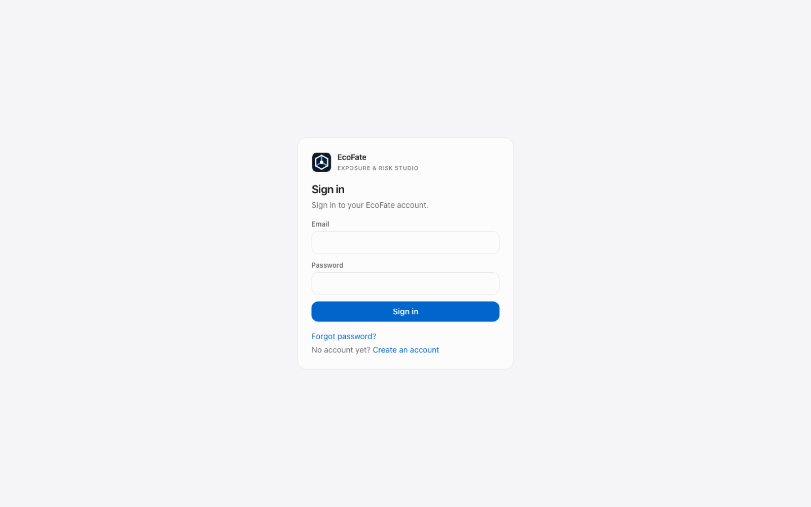

The first visit opens a welcome card with the three things to know: bring your key, ask in plain
words, read the results.

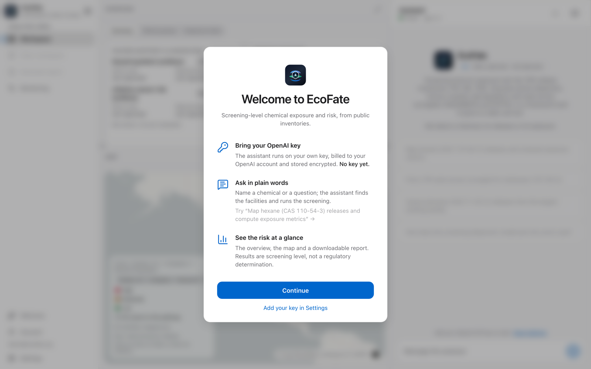

## 2. Ask, and be asked back

The user asks about hexane. The agent looks the chemical up first and finds that no source has
an inhalation unit risk for it, the benchmark a cancer risk needs. It stops before assessing
anything and asks: enter the value with its unit, or proceed without it. Nothing is guessed
([how it decides](../agent/README.md)).

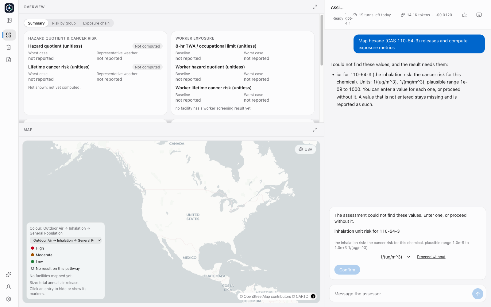

## 3. The agent works

The user proceeds without the value. The turn runs in a background worker; the chat shows the
step in progress and a Stop button, and a reload would pick the same turn up again
([worker](../worker/README.md)).

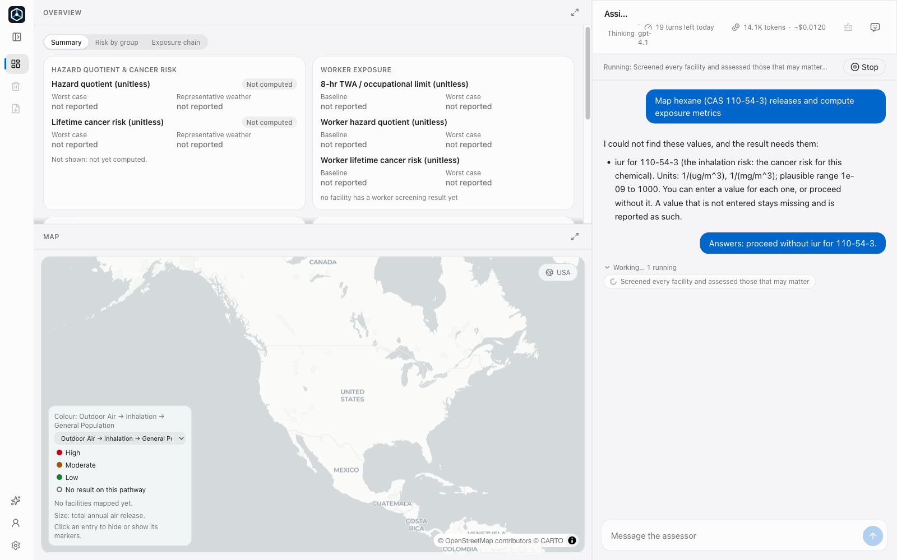

## 4. The answer and the dashboard

About five minutes later the answer arrives: 1,255 facilities reporting hexane releases were
screened and 157 have a worst-case result. The chat
gives the summary, a results table, comments and limitations; the overview and the map fill in
from the same results. The cancer risk reads "Not computed", because the value the user declined
stays absent.

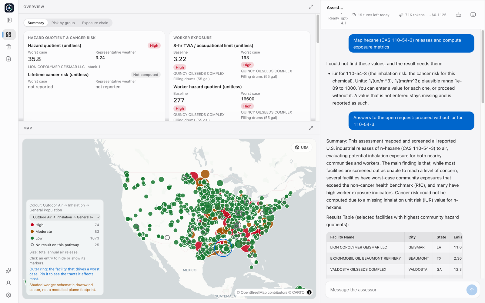

## 5. Read the results three ways

**Summary:** the worst-case and representative hazard quotient for the community, and the worker
screening, each with its band in words and the facility that drives it.

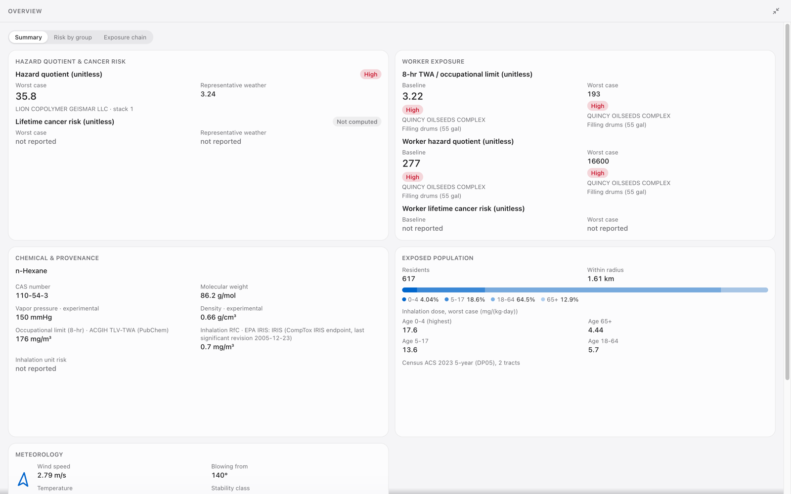

**Risk by group:** the highest worst-case value by industry, by TSCA condition of use and by life
cycle stage, against the moderate and high thresholds.

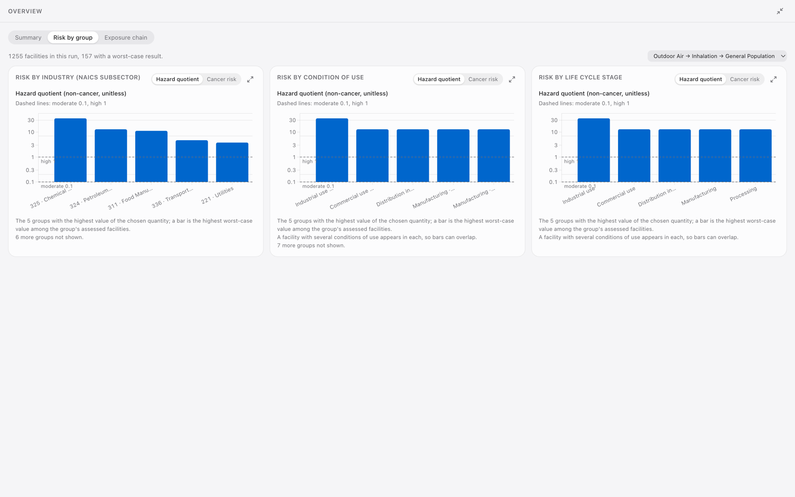

**Exposure chain:** how the worst case arises, from the reported release through the air pathway
and the inhalation route to the receptor and the risk, for the community and for workers.

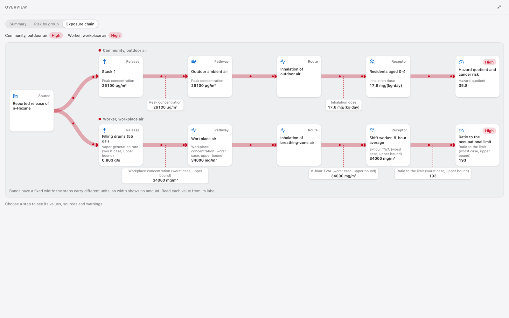

## 6. Look at the map

Every facility is a marker: its size is the annual air release, its colour the screening band of
the chosen pathway. The legend counts each band (74 high, 83 moderate, 1,073 low).

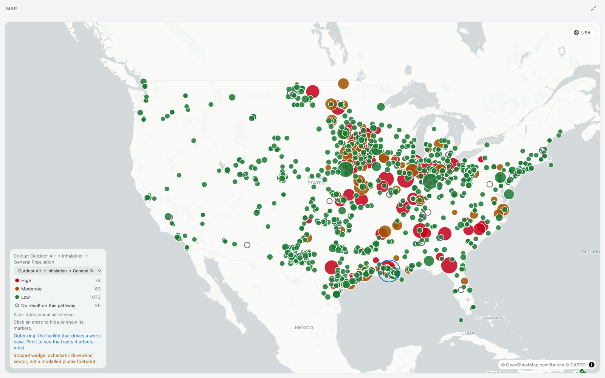

A click opens the facility: identifiers, industry, bands, reported release, conditions of use,
stacks and its worst-case scenarios.

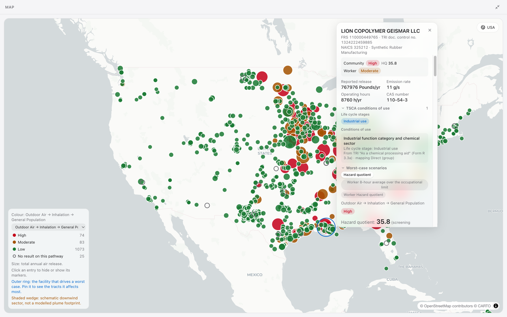

## 7. Monitoring

Every turn is traced to Logfire. An administrator sees the recorded sessions with their estimated
cost and status ([monitoring](monitoring.md)).

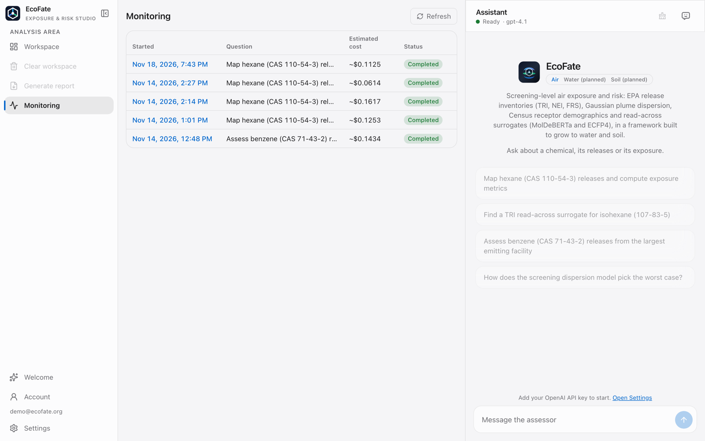

Opening a session shows its timeline: each model call with its tokens, each tool call with its
duration, and a link to the full trace. This is the session above: the first turn stops after
the chemical lookup; the second runs the batch assessment.

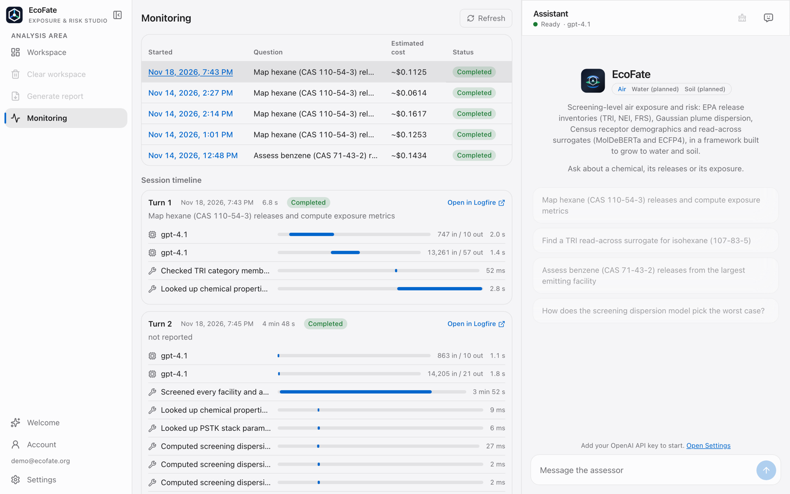

## 8. Evaluation results

The scripted scenarios replay recorded tool outputs against the real chat model and check what
the agent did. This is the report of the "missing benchmark" scenario, the behaviour shown in
step 2: the run completed, the properties were looked up, no exposure was computed, and the
agent asked for the unit risk ([scenarios](../evals/docs/scenarios.md)).

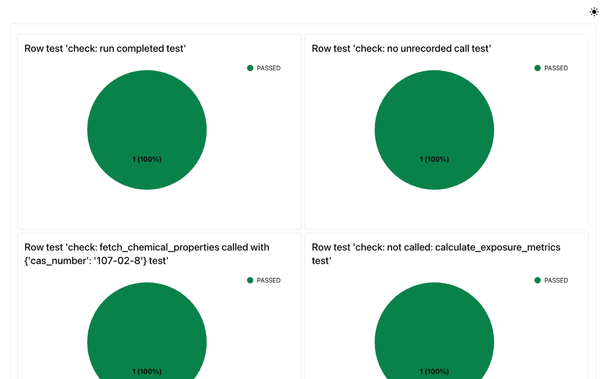

The LLM judge that scores full answers was tuned against 50 labelled answers over six prompt
iterations ([judge tuning](../evals/docs/judge-tuning.md)):

| Judge prompt | Accuracy | Precision | Recall |
|---|---|---|---|
| Baseline | 0.68 | 0.53 | 1.00 |
| Iteration 4 | 0.72 | 0.58 | 1.00 |
| Iteration 6 (kept) | 0.78 | 0.64 | 0.95 |
