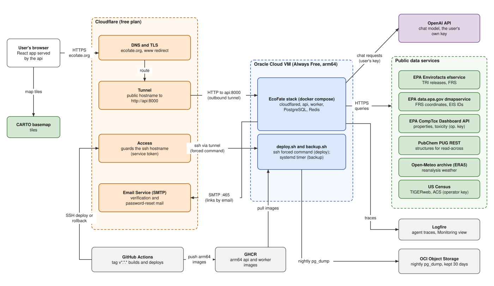
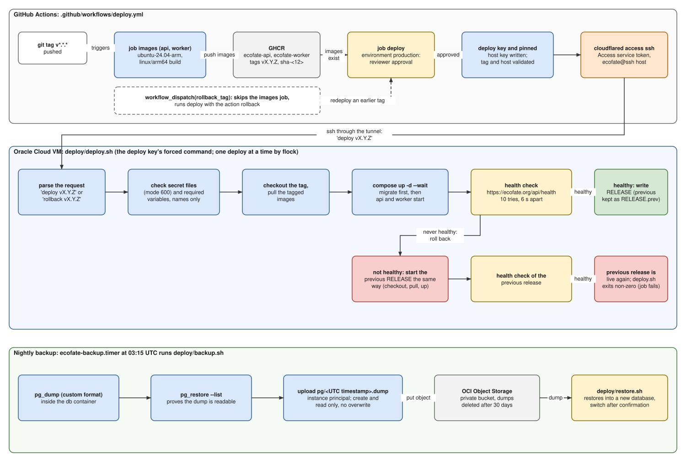

[← Documentation index](../../README.md#documentation) · [All docs](../README.md)

# Deploying EcoFate (Oracle Cloud Always Free + Cloudflare)

EcoFate runs in production at **https://ecofate.org** on one Oracle Cloud Always Free virtual
machine, with the same docker compose stack as local development. Cloudflare serves the site
through a tunnel, so the VM accepts no connection from the internet. Cost: **USD 0 a month**.

*Browser to Cloudflare to the VM through an outbound tunnel; GitHub Actions builds images and deploys over SSH through the same tunnel.*

| Piece | Where it lives |
|---|---|
| Provision / teardown / first login | `deploy/oci/provision.sh`, `teardown.sh`, `bastion-ssh.sh` (`make deploy-provision`, `deploy-teardown`, `deploy-ssh`) |
| Production compose overrides | `compose.prod.yaml` |
| Production settings (no secrets) | `config/settings.production.toml`, switched on by `ECOFATE_SETTINGS_PROFILE=production` |
| Secrets (only on the VM) | `/opt/ecofate/.env.prod`, `/opt/ecofate/tunnel.env` (templates: `deploy/*.example`) |
| Deploy | `.github/workflows/deploy.yml` → `deploy/deploy.sh` |
| Backups / restore | `deploy/backup.sh` + `ecofate-backup.timer`, `deploy/restore.sh` |

## Keeping it free

- Use only Always Free shapes: `provision.sh` refuses more than 4 OCPUs, 24 GB of memory or a
  200 GB disk before creating anything.
- Upgrade the tenancy to **Pay As You Go** (Billing & Cost Management → Upgrade and Manage
  Payment; add a payment method first). Within Always Free limits the bill stays at zero, and
  Oracle no longer reclaims Always Free VMs that sit idle for a week.
- Create a **budget alert at USD 1** (Billing & Cost Management → Cost Management → Budgets).
- Cloudflare's free plan covers the tunnel, Access (up to 50 users), DNS and the certificate.

*How a release is deployed and how a failed health check rolls back ([details](release-and-rollback.md)).*

## Steps

Follow them in this order; each page ends with a link to the next.

1. [Prerequisites and provisioning the VM](prerequisites-and-provision.md): accounts, OCI CLI, `make deploy-provision`, capacity errors
2. [Cloudflare Tunnel and Access](cloudflare.md): the tunnel, its routes, the service token, the Access application, zone settings
3. [First login and the secret files](first-login-and-secrets.md): Bastion login, `.env.prod`, `tunnel.env`, email settings
4. [The deploy key and GitHub settings](deploy-key-and-github.md): the restricted SSH key, secrets, variable, `production` environment
5. [First release and rollback](release-and-rollback.md): tagging, the first manual deploy, the first administrator, rolling back, the rollback drill
6. [Logs, backups and restore](logs-backups-restore.md): reading logs, nightly dumps, restoring, the restore drill
7. [Teardown and security notes](teardown-and-security.md): removing everything, what to protect
