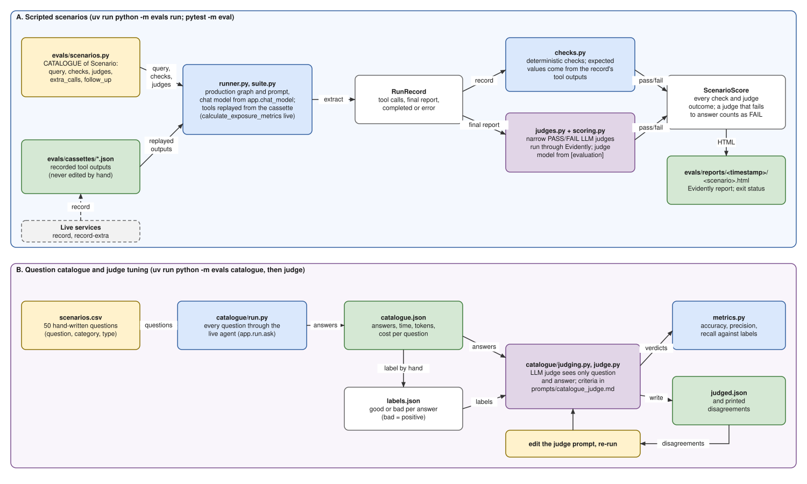

[← Documentation index](../README.md#documentation) · [Architecture](../docs/architecture.md) · [Agent](../agent/README.md) · [Prompts](../prompts/README.md)

# evals/

Behavioural evaluation of the agent: the production graph, prompt and tool descriptions run with a
real chat model and what it did is scored. Nothing in the project imports `evals`. There are two
instruments: a small set of **scripted scenarios** with recorded tool outputs and code checks, and a
**catalogue** of 50 hand-written questions that is run live, labelled by hand and then judged by an
LLM judge that is itself scored against the human labels. Rules for coding agents: `evals/CLAUDE.md`.

## Contents

- [Pipeline](#pipeline) (below)
- [Scripted scenarios and prompt decisions](docs/scenarios.md): the four runnable scenarios, cassettes, and the decisions taken from evaluation evidence
- [The catalogue and its labels](docs/catalogue-and-labels.md): the 50 hand-written questions and how the labels were produced
- [The LLM judge and its tuning](docs/judge-tuning.md): the judge, its metrics and the iterations
- [Running it and its cost](docs/running-and-cost.md): commands, CI and what a run costs

## Pipeline

*Drawn from `evals/__main__.py`, `evals/runner.py`, `evals/cassette.py`, `evals/scoring.py`, `evals/catalogue/` and `config/settings.toml` `[evaluation]`.*

The agent's model is built by `app/chat_model.py` from `[agent]`, the same model the program runs;
the judge model comes from `[evaluation]` (`judge_model`, pinned).

| Module | Role |
|---|---|
| `record.py` | run record types |
| `cassette.py` | record and replay of tool outputs |
| `runner.py` | agent run and record extraction |
| `checks.py` | deterministic checks |
| `judges.py` | the narrow PASS/FAIL criteria of the scenario judges |
| `scoring.py` | Evidently adapter and the report (the only module that imports `evidently`) |
| `scenarios.py` | the scripted scenarios |
| `catalogue/` | the question catalogue (`scenarios.csv`), its reader, the batch runner, the catalogue judge and its metrics |
| `__main__.py` | the command line: `record`, `record-extra`, `run`, `catalogue`, `judge` |
