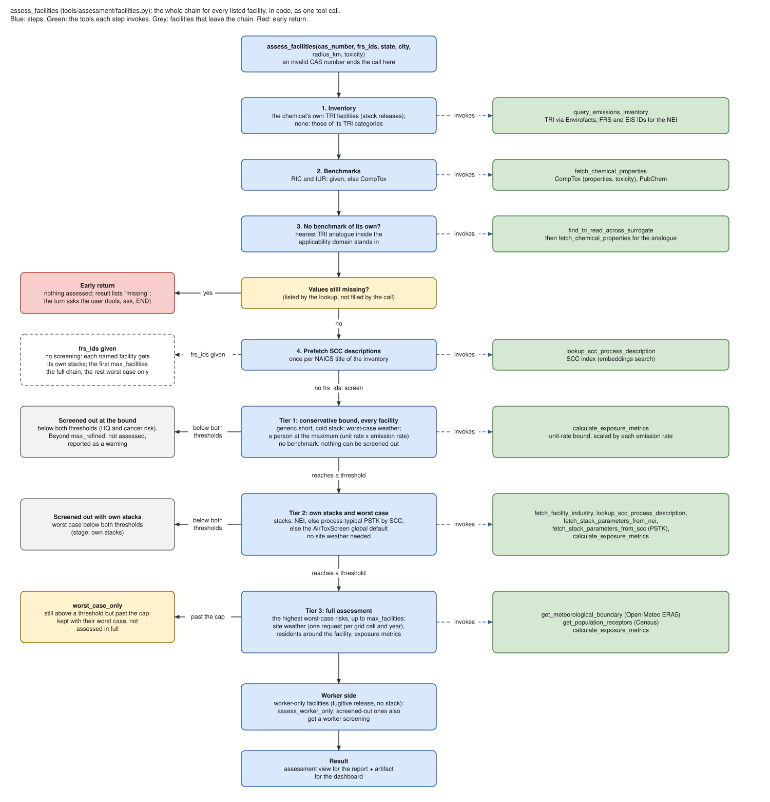

[← Documentation index](../README.md#documentation) · [Architecture](../docs/architecture.md) · [Agent](../agent/README.md) · [Models](../models/README.md)

# tools/

The agent's tools: each one is a typed LangChain `@tool` that reads a data service or a local
table and returns a typed result. A tool never calls an LLM and never imports `agent/`; the
equations come from [`models/`](../models/README.md). The agent reads the tools only through
`tools/registry.py`. Rules for coding agents: `tools/CLAUDE.md`.

## Contents

- [Layout](#layout)
- [Summary](#summary)
- [The batch assessment](#the-batch-assessment)
- [Tool reference](#tool-reference)
- [Adding a tool](#adding-a-tool)
- [Testing](#testing)

## Layout

    tools/
      registry.py            ToolRegistry + ALL_TOOLS / get_all_tools()
      schemas.py             TypedDicts shared by tool inputs and outputs
      credentials.py         per-call keys (PROVIDER_KEY, CENSUS_KEY, COMPTOX_KEY)
      http.py, digits.py     shared by the tool folders (retrying JSON client, digit-string ids)
      informatics/           properties.py, category.py, read_across.py, helpers/
      emissions/             inventory.py, industry.py, process.py, stack.py, profile.py, rag/, helpers/
      exposure/              meteorology.py, population.py, metrics.py, helpers/
      assessment/            facilities.py (the batch assessment), helpers/

Each tool is one module (or a small family) and its helpers sit in a same-named subfolder of
`helpers/`. Each folder's `__init__.py` exports its `TOOLS` list, which the registry collects. SCC
retrieval (the `lookup_scc_process_description` tool) lives in `emissions/rag/`.

## Summary

| Tool | Input | Output | Data source | Key needed | Limits |
|---|---|---|---|---|---|
| `fetch_chemical_properties` | CAS number | preferred name, molecular weight, vapor pressure, density, `rfd`, `rfc`, `sf` and `iur`, with sources and warnings | EPA CompTox (IRIS, ToxVal); PubChem as a fallback for three properties | `COMPTOX_API_KEY` | PubChem at most 5 requests a second; never supplies the name or a toxicity value |
| `find_tri_category` | CAS number | the TRI categories that list the chemical (code and name) | `data/chemicals_in_tri_categories.csv` | none | membership is a listing fact, not an estimate |
| `find_tri_read_across_surrogate` | CAS number, optional filters | the closest TRI chemical, both component scores, applicability-domain flag | `data/tri_chemicals/` catalog and the MolDeBERTa encoder (Hugging Face) | none | encoder about 500 MB, licence CC BY-NC-ND 4.0 (non-commercial); never returns toxicity values |
| `query_emissions_inventory` | CAS number, optional state and city | TRI facilities with latest stack-air release, location and emission rate (g/s) | EPA Envirofacts (TRI), FRS | none | last 2 reporting years; the model sees only the largest `[tri] max_listed` facilities |
| `fetch_facility_industry` | TRI control number | primary NAICS code and title | EPA Envirofacts | none | says whether the code was reported or assigned by EPA |
| `lookup_scc_process_description` | NAICS text | candidate SCC process descriptions | `data/epa_scc_to_epa_emission_sector.csv.gz`, semantic search | OpenAI key for the embeddings | a bare NAICS code is refused; the title is needed |
| `fetch_stack_parameters_from_nei` | FRS ID | the facility's distinct NEI stacks, as candidates | `data/nei_stacks/`, Envirofacts FRS tables | none | about a quarter of TRI facilities have NEI stack data |
| `fetch_stack_parameters_from_scc` | SCC code | EPA PSTK defaults or the AirToxScreen global point-source default | `data/pstk.csv` | none | the global default gives much higher concentrations |
| `get_meteorological_boundary` | latitude, longitude, optional year | annual mean wind speed, prevailing direction, stability class, temperature | Open-Meteo historical archive (ERA5) | none | annual representatives on about a 25 km grid; free tier is non-commercial |
| `get_population_receptors` | latitude, longitude, optional radius (km) | residents and age mix | Census TIGERweb and ACS 5-year | `CENSUS_API_KEY` | assumes people are spread evenly over tracts; no sampling error |
| `calculate_exposure_metrics` | candidate stacks, emission rate, weather, population, toxicity | concentration, dose per age band, hazard quotient and cancer risk, worst case and representative | computed with `models/` (SCREEN3 method) | none | flat terrain, rural dispersion, no building downwash |
| `assess_facilities` | CAS number, optional place, FRS IDs, radius, toxicity | tiered screening of every facility and full assessments of those that may matter | composes the tools above | CompTox, Census and the OpenAI key (SCC embeddings) | see below |

Each tool's docstring is what the model reads: when to use it, how to read its result and what
follows. The per-tool notes below say the same for people.

## The batch assessment

*Drawn from `tools/assessment/facilities.py`, its `helpers/` and the `[assessment]` tables of `config/settings.toml`.*

`assess_facilities` (in `tools/assessment/`, the one folder allowed to compose the others) runs the
whole exposure chain for every facility of a chemical in code instead of one model call per
facility. It follows EPA's tiered approach and excludes a facility only on a conservative bound:

1. **Bound:** a generic short, cold stack, worst-case weather and a person at the maximum. A facility
   whose bound is below both thresholds (`[assessment.screening]`: hazard quotient 0.1, cancer risk
   1e-6) is screened out.
2. **Own stacks:** the others get their own stacks (NEI, else PSTK by SCC, else the global default)
   and their worst case; those still below are screened out too.
3. **Full assessment:** the highest worst-case risks (at most `[assessment] max_facilities`, 25) get
   the weather at the site, the residents and the representative case; the rest keep their
   own-stack worst case.

A facility that reports only a fugitive air release has no community result and gets a separate
worker screening. The result tells the model how many facilities fell in each tier, and the
complete result goes to the interface as the tool artifact.

## Tool reference

Each tool's docstring says when to use it and how to read its results. Behaviour, data sources and limits:

- **`fetch_chemical_properties`**: CAS -> SMILES -> CompTox, with Pint unit conversion to fixed units. When CompTox leaves molecular weight, vapor pressure or density empty, PubChem PUG View (no key, at most 5 requests a second, answers cached in `.cache/pubchem/`, `[pubchem]` in `config/settings.toml`) is asked for just those fields. Only a record that lists the requested CAS number is used, only a statement with one number and one unit counts (for vapor pressure, a temperature of 20-25 degC too), several statements must agree within a factor of 2, and the value is labelled `PubChem` in `sources` with a warning. PubChem never supplies the name or a toxicity value. Chronic RfD and RfC come first from CompTox's IRIS endpoint (`[comptox.iris]`; a text value is read only if it is one number and one expected unit, and a disagreement with ToxVal's copy of IRIS is a warning), then from ToxVal in the order of `source_priority`.
- **`query_emissions_inventory`**: CAS -> EPA TRI facilities with their latest reported stack-air release, location and an average emission rate in g/s at 8760 operating hours per year (configurable in `config/settings.toml`). Only the last 2 published TRI reporting years are read (`[tri] recent_years`; TRI for year N is released by June of N + 1). Each record carries the `doc_ctrl_num` and the primary NAICS code of its TRI submission, and only each submission's primary row is kept, so nothing is counted twice. The model is told only the largest `[tri] max_listed` facilities (highest emission rate first, with totals and optional `state` and `city` filters), because a widely reported chemical can have over a thousand and a model cannot rank them by eye; the complete list goes to the map as a tool artifact. Facilities whose TRI rows lack coordinates get them from EPA's FRS best-pick lookup (`[frs_point]`) in a few bulk requests.
- **`fetch_facility_industry`**: takes a TRI control number and returns the submission's primary NAICS code and its title in words (Envirofacts `tri_submission_naics` with `primary_ind = 1`, titles from `REF_NAICS`), saying whether the facility reported the code or EPA assigned it.
- **`lookup_scc_process_description`**: NAICS text -> candidate SCC process descriptions by semantic search over `data/epa_scc_to_epa_emission_sector.csv.gz` (a compact copy of the EPA table, Point rows only; rebuild from `data/raw/` with `uv run python -m scripts.compact_scc_table`). Uses OpenAI embeddings (`OPENAI_API_KEY`); the index is cached in `.cache/scc_index` and can be pre-built with `uv run python -m scripts.build_scc_index`. A bare NAICS code is refused; the title is what it needs.
- **`fetch_stack_parameters_from_nei`** (tier 1): takes a facility's FRS ID, finds its EIS facility ID(s) with the Envirofacts `FRS_PROGRAM_FACILITY` table, and returns the facility's distinct NEI stacks as candidates (real records, never averaged; near-identical ones merged, lowest stack first, at most `[stack.nei].max_candidates`). The agent passes them together to one exposure calculation. With none, it falls back to the SCC tool. The stacks come from `data/nei_stacks/` (gzip CSV shards, about 1.4 MB), built from the 2023 NEI SMOKE point flat file: put `nei_smoke_point_2023.zip` in `data/raw/` (git-ignored) and run `uv run python -m scripts.compact_nei_stacks`. Shard values are in SMOKE FF10 units (`[stack.nei.units]`) and are converted with Pint. Roughly a quarter of TRI facilities have NEI stack data.
- **`fetch_stack_parameters_from_scc`** (tier 2): EPA PSTK stack defaults for an SCC (a PSTK CSV is expected at `[stack.pstk].path`), falling back to the AirToxScreen global point-source default.
- **`get_meteorological_boundary`** (latitude, longitude, optional year): one year of hourly ERA5 reanalysis from the Open-Meteo historical archive (no API key; `[meteorology]`). Returns the annual mean 10 m wind speed (not below a configured minimum), the prevailing wind direction (most frequent 10 degree sector), the most frequent Pasquill-Gifford class (EPA's SRDT key by day and Turner's key at night, EPA-454/R-99-005) and the annual mean temperature in K. These are annual representatives on a roughly 25 km grid, not worst-case conditions. When inputs are invalid or the archive cannot be used, it returns a configured screening default labelled `source: "screening default"` with a warning. The free Open-Meteo tier is for non-commercial use (under 10,000 calls a day) and requires attribution (CC BY 4.0).
- **`get_population_receptors`** (latitude, longitude, optional radius in km, default one mile): estimates residents around a point and their age mix (0-4, 5-17, 18-64, 65+, in percent). It finds the census tracts that intersect the circle (Census TIGERweb), reads their ACS 5-year counts (Census Data API, vintage in `[population]`) and scales the total by circle area over tract land area, which assumes people are spread evenly over the tracts. **The Census Data API needs a free key** (https://api.census.gov/data/key_signup.html): set `CENSUS_API_KEY` in `.env`; without it every request is redirected to a "Missing Key" page. Tracts with missing ACS estimates are left out and counted in `warnings`. Invalid input, a missing or refused key, a failed service, or no census tract (open water, outside the United States) gives a labelled screening default. ACS sampling error is not propagated.
- **`calculate_exposure_metrics`**: turns a facility's candidate stacks (all in one call, so the per-stack loop runs in code rather than in the model), the emission rate, the weather, the population and the toxicity values into a screening air concentration, dose per age band, hazard quotient and cancer risk for each stack, plus the range over the stacks with the stack behind each end. The method is EPA's SCREEN3 (EPA-454/B-95-004): the worst case is the highest ground-level concentration over 54 combinations of stability class and 10 m wind speed, and over distances from 100 m to 10 km (the Briggs dispersion coefficients in `models/transport/dispersion.py` are valid only to 10 km), with Briggs plume rise, stack-tip downwash, the wind-profile power law and the 1-hour to annual factor 0.08 (EPA-454/R-92-019). A `representative` result uses the weather of the meteorology tool. Exposure factors are the EPA RSL resident-air defaults; age-band inhalation rates and body weights come from the 2011 Exposure Factors Handbook. Every constant is in the `[exposure]` table with its source. When a stack is generic (the EPA global default), the result says so, since it gives much higher concentrations. Limits: flat terrain, rural dispersion, no building downwash, no mixing-height limit, so it can understate unstable-weather impacts; the maximum may be where nobody lives. Anything it cannot compute is null with a warning; nothing is defaulted.
- **`find_tri_read_across_surrogate`** (CAS number, optional IRIS-benchmark and NAICS-prefix filters): finds the TRI chemical closest in structure to a chemical that is not on the TRI list or has no inhalation benchmark, following EPA's Generalized Read-Across (GenRA) idea. It scores every TRI chemical by alpha x the cosine of their MolDeBERTa embeddings (`SaeedLab/MolDeBERTa-base-123M-mtr`, mean-pooled, pinned revision) plus (1 - alpha) x the Tanimoto similarity of their ECFP4 fingerprints (RDKit Morgan, radius 2, 1024 bits), with alpha 0.55. It calls the best match inside the applicability domain when the score is at least 0.60 (`[read_across]`). The cosine is taken after subtracting the catalog's mean embedding, because raw vectors occupy a narrow cone (the lowest raw cosine between any two TRI chemicals is 0.424); centering restores the ranking and brings the in-domain share from 94.7% to 66%. The 0.60 threshold is calibrated from the catalog's leave-one-out nearest-neighbour distribution (p33 = 0.597, median 0.687), and is deliberately conservative: a homologue such as n-heptane scores 0.938 and is in domain, but a branched isomer such as isohexane scores 0.554 and is reported as outside it. Treat the surrogate as a ranked candidate and read both component scores, not the flag alone. A score is relative to the catalog it was computed against. It reports the query/surrogate molecular-weight ratio but never applies it, and never returns toxicity values. The catalog (`data/tri_chemicals/`, one parquet shard per leading CAS digit) is built with `uv run python -m scripts.build_tri_embeddings` (about a minute on rebuilds; about 4 minutes from scratch). **The model (about 500 MB) is downloaded from Hugging Face on first use**, and its licence (CC BY-NC-ND 4.0) allows non-commercial use only.

Two tools were added after the notes above were written; their docstrings are the full contract:

- **`find_tri_category`**: takes a CAS number and returns the TRI categories that list the chemical (for example chlorophenols, N084), from `data/chemicals_in_tri_categories.csv` (`[tri_categories]`). A chemical TRI reports only as a category member is not listed on its own; the answer must say so and that the releases cover the whole category. Membership is a listing fact: no similarity is involved, and an empty list says nothing about TRI reporting.
- **`assess_facilities`**: the batch assessment described [above](#the-batch-assessment). It returns `(content, artifact)`: the model reads a ranked, capped summary that says what was left out, the web workspace reads the complete artifact.

## Adding a tool

0. Put any equations in `models/` first (pure functions with units in the docstring) and have the tool call them.
1. Add a typed `@tool` function in the matching concern folder (or a new folder), e.g. `tools/emissions/my_tool.py`. Put shared payload types in `tools/schemas.py`. Write a rich docstring (purpose, `Args:`, `Returns:`): the model reads it to decide when and how to call the tool.
2. Add it to the `TOOLS` list in that folder's `__init__.py`.
3. For a new folder, import its `TOOLS` in `tools/registry.py` and register it in `_build_default_registry`.
4. Add the tool name to `tests/tools/test_registry.py` and add a test in the matching `tests/tools/<concern>/` folder.

Tool names must be unique; the registry raises `ValueError` on duplicates.

A tool whose result is too large for the model returns `(content, artifact)` with
`response_format="content_and_artifact"`, as `query_emissions_inventory` and `assess_facilities` do.
A tool that calls a provider or service gets its key per call from `tools/credentials.py`, never
stored on an object that outlives the call.

## Testing

Tests mirror the layout under `tests/tools/` (`tests/tools/emissions/test_stack.py` tests
`tools/emissions/stack.py`). Unit tests use fakes and never touch the network; live checks are
marked `smoke` (`uv run pytest -m smoke`; `comptox` and `census` need their keys).

    uv run pytest tests/tools
