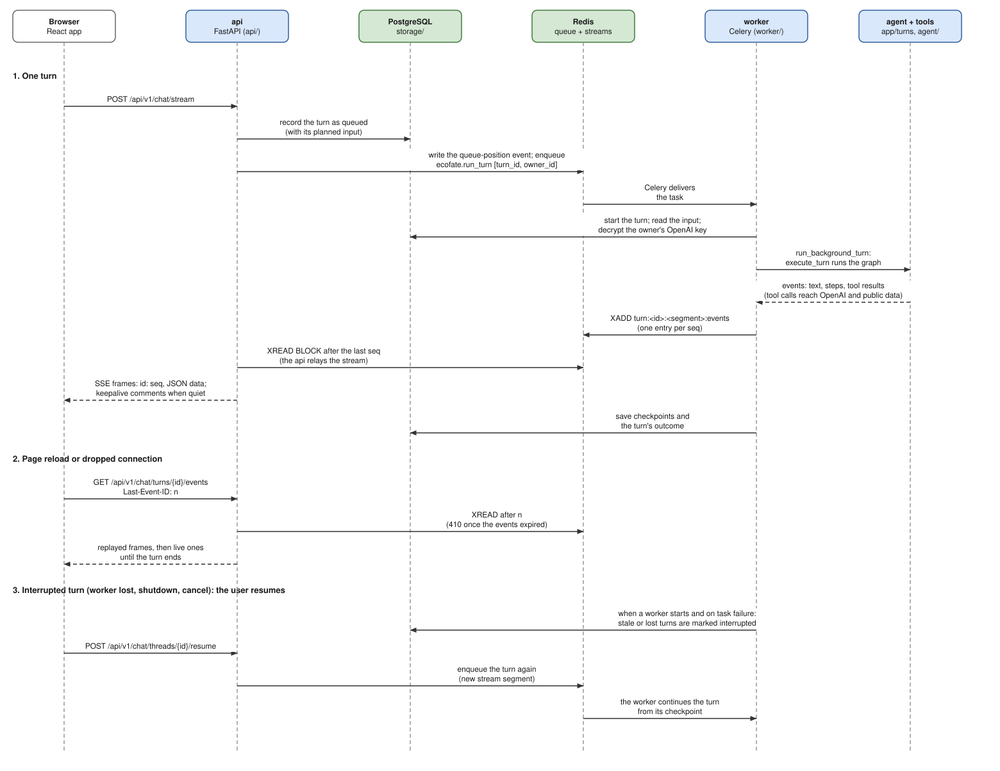

[← Documentation index](../README.md#documentation) · [Architecture](../docs/architecture.md) · [API](../api/README.md) · [Storage](../storage/README.md)

# worker/

The background workers of the web program: a thin Celery shell that runs the chat turns the API
queues, in two pools (`chat` for turns, `tools` for background tool jobs). Agent turns run for minutes, so they run in a separate, bounded pool instead of the request
that started them. Running, recording and publishing a turn is `app.turns.job.run_background_turn`,
so the API's in-process mode runs exactly the same code. Never put turn logic here. Rules for coding
agents: `worker/CLAUDE.md`.

## Contents

- [Modules](#modules)
- [A turn's sequence](#a-turns-sequence)
- [Background worker (Redis and Celery)](#background-worker-redis-and-celery)
- [Running it](#running-it)
- [Testing](#testing)

## Modules

| Module | What it holds |
|---|---|
| `celery_app.py` | builds the Celery app (`app.task_queue.build_celery`, from `[worker]`) and wires the process signals |
| `pool.py`, `__main__.py` | `python -m worker <chat\|tools>`: the `celery worker` command of one pool, its queue, concurrency and prefetch read from `[worker.<pool>]` |
| `tasks.py` | the one task, `ecofate.run_turn(turn_id, owner_id)`, ids only |
| `resources.py` | opens a child process's services (event loop, engine, checkpointer pool, Redis client, key vault, operator keys) |
| `recovery.py` | interrupts turns whose worker is gone |

## A turn's sequence

*Drawn from `api/routers/v1_chat.py`, `api/services/agent_runner.py`, `app/task_queue.py`, `app/turns/job.py`, `app/turns/bus.py` and `worker/tasks.py`.*

## Background worker (Redis and Celery)

Agent turns run for minutes, so they run in a separate, bounded pool instead of the request that started them; the [sequence above](#a-turns-sequence) shows the path.

- **What a task carries:** the turn id and its owner's id, nothing else (checked before sending). The worker reads the turn's input from PostgreSQL, decrypts the owner's OpenAI key itself, reads the operator's keys from its environment, and drops them when the turn ends.
- **Live events:** each turn segment has a Redis Stream, capped (`[worker].event_stream_max_length`) and kept `[worker].event_ttl_seconds` after it ends. Every event carries its position as the SSE id, so a reloaded page or a dropped connection reattaches with `Last-Event-ID` (`GET /api/v1/chat/turns/{id}/events`) and misses nothing.
- **Two pools:** each pool is its own container and consumes only its queue: `worker` runs `python -m worker chat` (queue `[worker.chat].queue`, task `ecofate.run_turn`) and `tool-worker` runs `python -m worker tools` (queue `[worker.tools].queue`, task `ecofate.run_job`). The API and the worker route each task name to its queue from the same settings (`app.task_queue.task_routes`), so a long job never delays a question. Each pool has its own concurrency, prefetch and time limits.
- **Stop and limits:** `POST /api/v1/chat/turns/{id}/cancel` stops a turn after its current step. A turn past `[worker.chat].soft_time_limit_seconds` stops the same way (`time_limit`); the hard limit kills the child as a backstop. Tasks are acknowledged late, prefetched one at a time and never re-run automatically.
- **Watching it:** `make worker-logs` (or `docker compose logs -f worker tool-worker`) follows both pools and shows each turn the worker runs, by turn id only. With monitoring on, one Logfire trace spans the API's enqueue span and the worker's turn span, which records how long the turn waited in the queue.
- **Settings:** `[worker]`, `[worker.chat]` and `[worker.tools]` in `config/settings.toml` (per pool: queue, concurrency, prefetch, soft and hard time limits; shared: visibility timeout, heartbeat, stream sizes, `heavy_tools`, `max_open_jobs_per_user`); the Redis URL only in the environment (`REDIS_URL`).

## Running it

    make db && make migrate && make redis                          # PostgreSQL and Redis (Docker)
    uv run python -m worker chat                                   # runs the turns (queue chat)
    uv run python -m worker tools                                  # runs the background tool jobs (queue tools)
    make worker-logs                                               # in Docker: follow both workers' logs

In Docker the `worker` and `tool-worker` services start with the stack. To run turns inside the API instead (no Redis,
no worker; single-user development only), set `[worker].eager = true` in `config/settings.toml`.
After a worker restart, turns whose heartbeat is older than `[worker].stale_after_seconds` become
`interrupted` and the user can resume them ([storage](../storage/README.md#conversation-storage)).

## Testing

Tests (`tests/worker/`) run the task eagerly on a stand-in runtime and a `memory://` broker, so they
need neither Redis nor a running worker. The job itself is tested in `tests/app/turns/test_job.py`
with an in-memory event bus and in-memory stores. Tests against a real Redis are marked `redis`:

    uv run pytest tests/worker
    make test-redis
